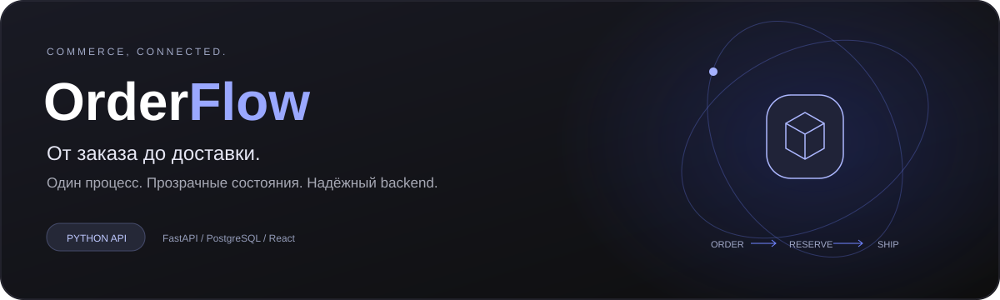
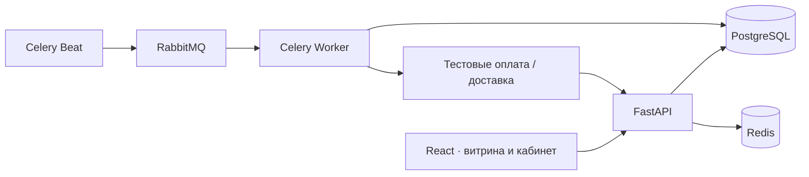

<p align="center">
  
</p>

<p align="center">
  <strong>Заказы, остатки и доставка в одном рабочем пространстве.</strong><br />
  Учебная платформа для независимых интернет-магазинов с акцентом на надёжный Python backend.
</p>

<p align="center">
  <a href="https://github.com/Tamirlanv/order_flow/actions/workflows/checks.yml"></a>
  
  
  
  
</p>

<p align="center">
  <a href="#quick-start">Быстрый старт</a> ·
  <a href="#status">Что работает</a> ·
  <a href="#architecture">Архитектура</a> ·
  <a href="#checks">Проверки</a> ·
  <a href="docs/PLAN.md">План разработки</a>
</p>

> [!NOTE]
> Сейчас реализуется **M01 — основа приложения**. API и интерфейс запускаются локально без Docker. Заказы, аккаунты, платежи и доставка ещё не реализованы. Полная проверка PostgreSQL, RabbitMQ и Docker-образов отложена: контейнеры по указанию владельца проекта не запускаются.

## Зачем OrderFlow

Небольшому магазину нужен единый процесс: получить заказ, зарезервировать товар, подтвердить оплату и передать отправление в доставку. OrderFlow проектируется так, чтобы повторный webhook не создавал повторную операцию, два покупателя не получали последний товар одновременно, а временный сбой провайдера не терял заказ.

| Заказы | Остатки | Интеграции |
| --- | --- | --- |
| Витрина и партнёрский API | Атомарное резервирование | Очереди и ограниченные повторы |
| История переходов и роли | Защита от перепродажи | Идемпотентная обработка событий |
| Независимые магазины | Освобождение по дедлайну | Тестовые оплата и доставка |

Это **целевые возможности MVP**, а не перечень уже готовых функций. Проверяемые критерии описаны в [ТЗ](docs/REQUIREMENTS.md).

<a id="status"></a>
## Что работает сейчас

- FastAPI: сведения о приложении, OpenAPI, liveness и readiness с ограниченным временем ожидания.
- React-интерфейс: обзор, план развития, состояние подключения к API и повтор запроса при ошибке.
- Конфигурация через окружение, SQLAlchemy engine, базовая ревизия Alembic.
- Подключение Celery без бизнес-задач и без автоматического запуска воркеров.
- Зафиксированные зависимости, проверки исходников, Dockerfile и Compose.

**Readiness возвращает 503, когда PostgreSQL, Redis или RabbitMQ недоступны.** Успех `/health/live` подтверждает только работу процесса API. Offline SQL Alembic не подтверждает выполнение миграций на БД.

<a id="quick-start"></a>
## Быстрый старт без Docker

Нужны **Python 3.12** и **Node.js 24**. Команды — для PowerShell из корня репозитория. Для запуска интерфейса и liveness база данных не требуется.

### 1. Подготовить зависимости

```powershell
python -m venv backend/.venv
backend/.venv/Scripts/python.exe -m pip install -r backend/requirements-dev.lock
npm --prefix frontend ci
```

Если `python` открывает Microsoft Store или недоступен, используй установленный Python 3.12 (`py -3.12 -m venv backend/.venv`) либо абсолютный путь к его исполняемому файлу. Пути конкретного компьютера в проект не зашиты.

### 2. Запустить backend

```powershell
cd backend
.venv/Scripts/python.exe -m uvicorn app.main:app --host 127.0.0.1 --port 8000 --no-access-log
```

### 3. Запустить frontend в другом терминале

```powershell
cd frontend
npm run dev
```

Открой **[http://127.0.0.1:5173](http://127.0.0.1:5173)**. Vite перенаправляет `/api`, `/docs` и `/openapi.json` на локальный backend. Шрифт поставляется вместе с приложением, без обращения к Google Fonts.

| Адрес | Назначение |
| --- | --- |
| `http://127.0.0.1:5173` | Интерфейс |
| `http://127.0.0.1:8000/docs` | Интерактивная документация API |
| `http://127.0.0.1:8000/health/live` | Работает ли API-процесс |
| `http://127.0.0.1:8000/health/ready` | Доступность PostgreSQL, Redis и RabbitMQ |
| `http://127.0.0.1:8000/api/v1/system` | Публичные сведения о версии и стадии |

Остановить каждый сервер — `Ctrl+C` в соответствующем терминале.

### Конфигурация

Для локального просмотра достаточно development defaults. Если нужны другие параметры, скопируй `.env.example` в `.env` и измени значения; для Vite установи `PUBLIC_APP_URL=http://127.0.0.1:5173`. Файл читается из корня независимо от рабочей директории. Реальные секреты в Git не добавляются.

В production приложение отказывается стартовать с демонстрационными секретами и HTTP origin. Проверка конфигурации не означает готовность к production: развёртывание сейчас не входит в выполненную работу.

<a id="architecture"></a>
## Архитектура

Модульный монолит: один backend и общие правила, отдельные процессы API, worker и scheduler. PostgreSQL хранит бизнес-состояние; Redis — временные данные; RabbitMQ — сообщения.



Схема показывает **целевую архитектуру**. Бизнес-обработчики и имитаторы появятся на следующих этапах.

| Слой | Стек |
| --- | --- |
| API и валидация | Python 3.12, FastAPI, Pydantic 2 |
| Данные | PostgreSQL 17, SQLAlchemy 2, psycopg 3, Alembic |
| Фоновые процессы | Celery 5, RabbitMQ 4, Redis 7.4 |
| Интерфейс | React 19, TypeScript, Vite, TanStack Query |
| Качество | pytest, Ruff, mypy, Vitest, Testing Library, ESLint, Prettier |
| Окружение | Docker Compose, Nginx, Mailpit; запуск отложен |

Подробности транзакций, изоляции магазинов и данных — в [архитектуре](docs/ARCHITECTURE.md).

<a id="checks"></a>
## Проверки

Все доступные проверки одной командой из корня (нужен Docker CLI только для разбора Compose, без Engine):

```powershell
./scripts/check.ps1
```

Отдельно backend:

```powershell
cd backend
.venv/Scripts/python.exe -m ruff check app tests migrations
.venv/Scripts/python.exe -m ruff format --check app tests migrations
.venv/Scripts/python.exe -m mypy app
.venv/Scripts/python.exe -m pytest -q
.venv/Scripts/python.exe -m alembic upgrade head --sql
```

Отдельно frontend:

```powershell
cd frontend
npm run check
```

CI в GitHub Actions повторяет проверки исходников на Python 3.12 / Node 24. **CI не запускает контейнеры, не публикует образы и не развёртывает приложение.** Инфраструктурные зависимости в текущих API-тестах заменены тестовыми адаптерами. Последние фактические результаты и отложенные проверки — в [плане](docs/PLAN.md).

## Docker: конфигурация подготовлена

Проверка без запуска, из корня:

```powershell
docker compose --env-file .env.example --profile app config --quiet
```

> [!IMPORTANT]
> Сборка образов и запуск контейнеров пока не проверены и не разрешены. Следующие команды предназначены для будущего этапа M01b после снятия ограничения и настройки `.env`.

```powershell
docker compose up -d
docker compose --profile app build
docker compose --profile app run --rm api alembic upgrade head
docker compose --profile app up -d
```

Будущие адреса Compose: интерфейс `localhost:8080`, API `localhost:8000`, Mailpit `localhost:8025`, RabbitMQ UI `localhost:15672`. Импорт/экспорт, имитаторы и мониторинг добавляются по мере реализации. Остановка: `docker compose --profile app down`; не удалять volumes, если данные нужны.

## Структура проекта

```text
backend/
  app/core/          конфигурация, БД, проверки зависимостей
  app/tasks/         точка входа Celery
  migrations/        история схемы Alembic
  tests/             тесты поведения API и настроек
frontend/
  src/               интерфейс и тесты
  public/            локальные ресурсы
docs/
  features/          спецификации до реализации
  assets/            оформление документации
scripts/check.ps1    локальные проверки без контейнеров
.github/workflows/   проверки исходников на push / pull request
```

## Разработка по спецификации

`Спецификация → feature-ветка → реализация → тесты → review diff → коммит → merge → push`

Каждая функция связывается с критериями приёмки. README и план обновляются вместе с кодом; незапущенные проверки не отмечаются успешными. Правила — в [AGENTS.md](AGENTS.md).

| Документ | Что внутри |
| --- | --- |
| [Техническое задание](docs/REQUIREMENTS.md) | Пользователи, границы MVP, критерии AC-01…18 |
| [Архитектура](docs/ARCHITECTURE.md) | Компоненты, таблицы, интеграции, безопасность |
| [План](docs/PLAN.md) | Этапы, текущий статус и препятствия |
| [Спецификации](docs/features/README.md) | Поведение каждой существенной функции |

## Дальше

- [x] Требования и архитектура.
- [x] Исходники API, стартовый интерфейс и локальные проверки.
- [ ] Проверка полного окружения M01b.
- [ ] Аккаунты, магазины, приглашения и восстановление пароля.
- [ ] Каталог, остатки и конкурентное резервирование.
- [ ] Тестовые оплата, компенсации и доставка.
- [ ] Импорт, отчёты, наблюдение и сквозная приёмка MVP.

Проект находится в активной разработке. Публичного рабочего стенда пока нет.
