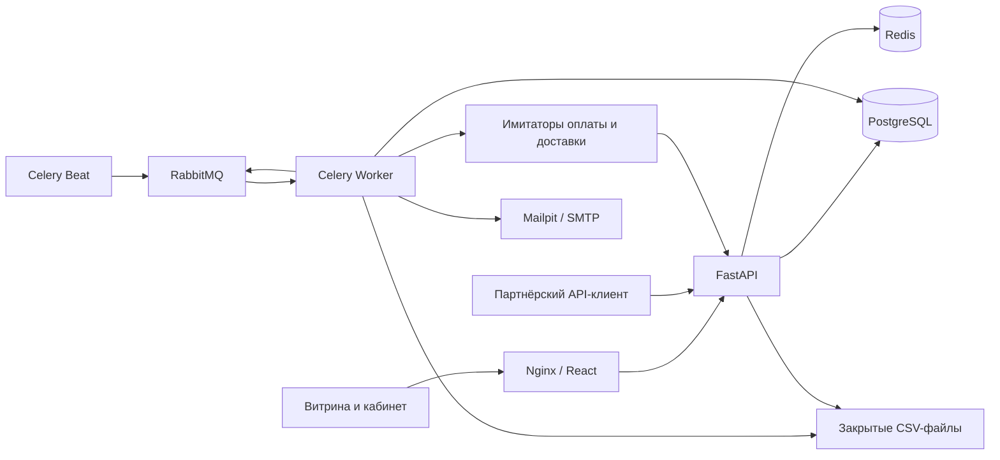

# Архитектура OrderFlow

Статус: целевая архитектура; с 2026-10-13 реализована основа M01a (API, UI, конфигурация и проверки без инфраструктуры). Остальные бизнес-компоненты ниже остаются планом. Продуктовые границы — в [ТЗ](REQUIREMENTS.md), последовательность — в [плане](PLAN.md).

## 1. Стек и выбор инструментов

| Область | Решение | Причина |
| --- | --- | --- |
| API | Python 3.12, FastAPI, Pydantic 2 | Типизированный HTTP API и async-интеграции |
| Данные | PostgreSQL 17, SQLAlchemy 2, Alembic | Транзакции, блокировки, ограничения и миграции |
| Драйвер | psycopg 3 | Синхронный доступ в Celery и асинхронный в API |
| Фоновые задачи | Celery 5, RabbitMQ 4 | Очереди, подтверждения обработки, отдельные воркеры |
| Планировщик | Celery Beat, один экземпляр | Истечение резервов, очистка файлов, запуск обработчика outbox |
| Временные данные | Redis 7.4 | Кэш каталога и ограничение частоты; не источник истины заказов |
| HTTP | httpx | Таймауты и тестируемые адаптеры провайдеров |
| Авторизация | Серверные сессии, Argon2id | Отзыв сессий и безопасное хранение паролей без ненужной сложности refresh JWT |
| Интерфейс | React, TypeScript, Vite, TanStack Query | Кабинет и витрина; HTTP-состояние без самописного кэша |
| Файлы | Закрытый локальный volume, интерфейс Storage | CSV MVP; возможность заменить на S3 без изменения бизнес-логики |
| Почта | SMTP → Mailpit локально | Проверка ссылок и уведомлений без внешних аккаунтов |
| Тесты | pytest, pytest-asyncio, httpx, Playwright | Правила, API, интеграции и несколько сквозных сценариев |
| Проверки | Ruff, mypy, TypeScript, ESLint, Prettier | Автоматическая проверка стиля и типов |
| Окружение | Docker Compose, Nginx | Отдельные процессы и один origin для браузера |
| CI | GitHub Actions, изолированный Compose без publish/deploy | Линт, типы, тесты, frontend build, миграции и инфраструктурные интеграции |
| Наблюдение | JSON-логи, Prometheus/Grafana на M09 | Поиск причин ошибок и измерение работы системы |

Dockerfile задают базовые линии Python/Node и major-версии инфраструктуры. Python-зависимости зафиксированы pip-tools в `requirements.lock` и `requirements-dev.lock`, npm — в `package-lock.json`. Lock-файлы Python фиксируют версии без хэшей; тесты выполняются на Windows/Python 3.12 и Linux в CI/Compose. Образы не закреплены digest; Mailpit зафиксирован на [релизе v1.31.4](https://github.com/axllent/mailpit/releases/tag/v1.31.4). Фактические проверки сборки описаны в плане.

## 2. Компоненты



Это модульный монолит: API и воркеры разделяют прикладные правила и модели, но запускаются отдельными процессами. Имитаторы — отдельный тестовый HTTP-сервис, который будет добавлен на M05; он не имеет доступа к таблицам заказов. Отдельные БД для бизнес-модулей, Kafka, Kubernetes и распределённые транзакции не нужны для MVP.

Планируемая структура backend:

```text
backend/app/
  main.py
  core/            # конфигурация, БД, логи, безопасность
  modules/
    identity/      # аккаунты, сессии, подтверждения, восстановление
    stores/        # магазины, членство, приглашения, API-ключи
    catalog/       # товары, SKU
    inventory/     # остатки, движения, резервы
    orders/        # заказы, переходы состояний
    payments/      # попытки оплаты и компенсации
    shipping/      # доставка
    jobs/          # импорт, отчёты, файлы, уведомления
  integrations/    # HTTP, SMTP, Storage
  tasks/           # Celery и расписания
```

HTTP handlers валидируют вход, проверяют доступ и вызывают прикладной сценарий. Сценарий определяет транзакционную границу. Правила не дублируются в HTTP handler и Celery task. AsyncSession используется в API, синхронная Session — в воркерах; сессии и соединения не передаются между процессами.

## 3. Данные и связи

| Сущность | Ключевые поля и связи |
| --- | --- |
| User | email (нормализованный unique), password_hash, email_verified_at |
| Session | user_id, token_hash, expires_at, revoked_at |
| Store | name, slug (unique), owner_user_id, timezone |
| Membership | store_id + user_id (unique), role; владелец представлен ролью owner |
| Invitation / EmailVerification / PasswordReset | назначение, hash токена, субъект, expires_at, used_at; raw токен не хранится |
| ApiKey | store_id, hash ключа, scopes, revoked_at |
| Product | store_id, title, description, archived_at |
| SKU | store_id, product_id, code (unique внутри магазина), attributes JSONB, price NUMERIC(14,2) |
| InventoryBalance | store_id + sku_id (unique), on_hand, reserved, CHECK ограничений |
| InventoryMovement | store_id, sku_id, delta, reason, actor_id, order_id, operation_key (unique в области магазина) |
| Order | store_id, number, status, total NUMERIC(14,2), currency, reservation_expires_at, buyer_access_hash |
| OrderItem | store_id, order_id, sku_id, quantity, snapshot title/price |
| Reservation | store_id, order_id, sku_id, quantity, state; unique(order_id, sku_id) |
| OrderEvent | store_id, order_id, previous/next status, actor, time, reason |
| Payment / Refund | store_id, order_id, provider_id, amount, currency, status, idempotency_key |
| Shipment | store_id, order_id (одна доставка в MVP), provider_id, status |
| WebhookInbox | provider, event_id (unique вместе с provider), проверенные данные, status, attempt_count |
| OutboxEvent | store_id, event_type, aggregate_id, payload, created_at, published_at |
| IdempotencyRecord | store_id, client_scope, key, request_hash, response/order_id, expires_at; составной unique |
| BackgroundJob / StoredFile | store_id, kind, status, counts/error, storage_key, expires_at |
| Notification | store_id, event_id, recipient, channel, status; unique для логической отправки |

Все бизнес-сущности магазина содержат `store_id`. Там, где возможна связь между магазинами, использовать составные внешние ключи `(store_id, id)`, а не только проверку в Python. Пользовательские идентификаторы — UUID; публичный номер заказа служит отображению, не секретом доступа.

Индексы MVP: `Order(store_id, created_at)`, `Order(store_id, status, created_at)`, активные резервы по expires_at, неопубликованный outbox, незавершённый inbox. Не добавлять индексы на каждый столбец: проверять EXPLAIN на реалистичных данных.

## 4. Переходы и конкурентные операции

Заказ: `awaiting_payment → paid → packing → shipped → delivered`. Из awaiting_payment доступна отмена/истечение; из paid/packing доступна отмена. Терминальные статусы `cancelled`, `expired`, `delivered`. Оплата, возврат и доставка имеют собственные статусы; их не смешивать с общим статусом заказа.

Создание заказа выполняется одной транзакцией: зарегистрировать ключ идемпотентности, заблокировать InventoryBalance для всех SKU в стабильном порядке, проверить доступность, сохранить snapshot цен, заказ, резервы, обновить reserved, создать outbox. При ошибке откатить всё. Конкурентный конфликт ключа идемпотентности возвращает уже созданный результат, а не повторяет операцию.

Оплата и истечение блокируют одну строку Order. Подтверждение допускается только если серверное время обработки меньше expires_at и состояние awaiting_payment. В момент дедлайна резерв считается истёкшим. Позднее событие оплаты идёт в компенсацию. Это намеренное упрощение учебного провайдера; часы провайдера не определяют дедлайн.

Отмена и отправка тоже блокируют Order, затем резервы/остатки в общем порядке. Первая завершившаяся транзакция определяет допустимость второй. При оплате резерв сохраняется до отправки/отмены, планировщик его не освобождает. Работа с сетью всегда после фиксации транзакции.

## 5. Очереди, outbox и внешние вызовы

Outbox записывается атомарно с бизнес-изменением. Периодический диспетчер отправляет события в RabbitMQ с подтверждением публикации и затем помечает запись. Сбой между публикацией и отметкой приводит к повторной доставке; обработчики обязаны её выдерживать. Периодическая сверка восстанавливает необработанные задания inbox/outbox.

Webhook сначала проверяется по подписи и сохраняется в inbox; HTTP-ответ подтверждает сохранение, а не завершение всей обработки. Уникальность event_id защищает от повторов. Обработчик выполняет переход и сохраняет результат транзакционно. Неверные события не изменяют заказ.

Celery: durable-очереди, persistent-сообщения, late ack, ограничение времени и восстановление после смерти воркера. Начальная политика сетевых повторов: до 5 попыток, экспоненциальная задержка с jitter, потолок 60 секунд. Повторять таймауты, 429 и временные 5xx; ошибки валидации показывать без бессмысленных повторов. Параметры уточняются тестами конкретного адаптера.

Для временных служебных control-очередей задано `control_queue_exclusive=True`: это совместимо с [ограничениями RabbitMQ 4.3](https://www.rabbitmq.com/docs/queues) и [настройками Celery](https://docs.celeryq.dev/en/stable/userguide/configuration.html#control-queue-exclusive). Durable-очереди бизнес-задач сохраняют persistent-сообщения; разрешение устаревших очередей в брокере не включается.

У каждого внешнего эффекта стабильный idempotency key. Имитатор возвращает тот же результат при повторном запросе. При неопределённом результате сначала сверять состояние по ключу; не создавать вторую доставку или возврат. Статус и причина исчерпания попыток видны менеджеру, ручной повтор проверяет права и состояние.

## 6. Авторизация и безопасность

Браузер использует непрозрачную серверную сессию в HttpOnly cookie, SameSite=Lax; Secure обязателен при HTTPS вне локальной разработки. Сервер хранит hash токена сессии. Изменяющие запросы проверяют CSRF-токен и origin. Frontend обращается к API через тот же Nginx origin; CORS ограничен явным локальным списком только для dev-режима.

Партнёрские API-ключи не используются в браузере и имеют scopes. Ответы для чужих объектов — 404, для запрещённых действий внутри доступного магазина — 403. Фоновые задачи получают store_id и actor_id и не доверяют пути к файлу от клиента.

Восстановление пароля описано в [отдельной спецификации](features/003-password-reset.md). Токены генерируются криптографически, в БД хранятся хэши; ссылка формируется из доверенного PUBLIC_APP_URL, не заголовка Host.

Файлы доступны через авторизованный endpoint; произвольные локальные пути не принимаются. Публичные статические каталоги не содержат отчёты. Логи связываются через request_id/job_id/order_id; не включают пароли, raw токены, адреса и email.

## 7. Инфраструктурные заготовки

В корневом `compose.yaml` инфраструктура включена по умолчанию, сервисы приложения — в профиле `app`, тестовый контейнер — `test`. API, worker и единственный beat используют образ `orderflow-backend:local`; frontend — сборку Vite и Nginx. Тестовая стадия backend добавляет dev-зависимости, runtime не содержит pytest. Файлы jobs разделяют закрытый volume API/worker. API, PostgreSQL, Redis и AMQP доступны только по внутренней сети Compose; наружу на loopback опубликованы Nginx 8080, Mailpit 8025 и RabbitMQ UI 15672.

Исходники и health endpoints добавлены на M01a. Alembic содержит baseline-ревизию; бизнес-таблицы появятся с функциями. На M01b пользователь разрешил Docker: проверяются build/run, реальные миграции и инфраструктура. Тест миграций создаёт отдельную UUID-БД и удаляет только её; основная БД сохраняется. Имитаторы и наблюдение добавляются в Compose на своих этапах.

Локально Vite проксирует `/api`, `/docs`, `/openapi.json` на `127.0.0.1:8000`; в Compose эту роль выполняет Nginx. Frontend поставляет шрифт Manrope локально. Образец `docs/README_example.md` использован только для композиции README, а пользовательский `docs/DESIGN.md` — для тёмной палитры и скруглений; эти исходные файлы не включены в наши коммиты. Основная кнопка тёмная согласно таблице цветовых токенов, фиолетовый применяется к акцентам.

## 8. Проверки архитектуры

- Unit: переходы, цены, правила ролей, вычисление дедлайнов.
- PostgreSQL-интеграции: миграции, constraints, конкурентные резервы, дубли, rollback и изоляция магазинов.
- RabbitMQ/Celery-интеграции: подтверждения, повторы, остановка воркера, восстановление inbox/outbox.
- HTTP-адаптеры: таймауты, 429/5xx, подпись webhook, несогласованные данные.
- Frontend/E2E: покупка, обработка менеджером, права, восстановление пароля.

Тесты с fake clock проверяют дедлайны без многоминутных ожиданий. Eager-режим Celery удобен для unit-тестов, но не доказывает корректность доставки и восстановления. Инфраструктурные тесты запускаются только с `RUN_INTEGRATION=1` в тестовом контейнере; обычный pytest явно пропускает их. M01b проверяет reconnect control-канала worker; повторную доставку бизнес-задачи проверять отдельно на M04c/M10.
